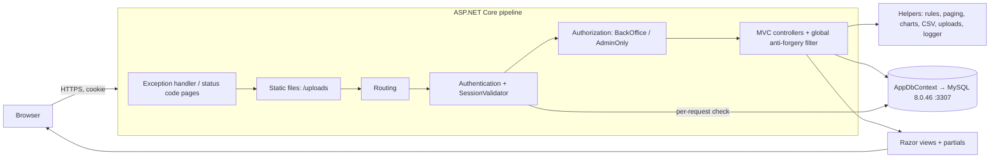

# Design Document: HeronSearch Admin

## Overview

HeronSearch Admin is a single ASP.NET Core MVC project (Razor views, C#) on net10.0 for Admin and Staff users of UMak's Lost & Found system. It uses EF Core 10 code-first with the Oracle provider MySql.EntityFrameworkCore 10.0.9 against MySQL Server 8.0.46 (localhost:3307, database `heronsearch`). Cookie authentication with two policies (BackOffice, AdminOnly) protects every page except Login, Signed Out, and the error pages.

The design follows the beginner constraints: plain MVC folders, `AppDbContext` injected straight into controllers, no repositories, MediatR, AutoMapper, or generic layers. Rules that can be wrong in subtle ways (paging, filters, item/claim/user rules, upload checks, CSV escaping, chart data, demo-data dates) sit in small static helper classes as pure functions. Controllers call them, and they can be tested without a database.

Delivery has two phases (Requirement 27). Phase 1 builds the complete data model and the one InitialCreate migration, so Phase 2 adds pages only and zero migrations.

### Key decisions

| Topic | Decision |
|---|---|
| Target framework | `net10.0` (.NET 10 LTS, supported to 2028-11-10; .NET 8 ends 2026-11-10; SDK 10.0.401 installed) |
| EF Core provider | MySql.EntityFrameworkCore 10.0.9 (Oracle), `options.UseMySQL(connectionString)`. Pomelo has no EF Core 10 release. Oracle's provider never auto-detects the server version, so migrations are created offline. License: GPL-2.0-only WITH Universal-FOSS-exception-1.0 |
| Design-time package / tool | Microsoft.EntityFrameworkCore.Design 10.0.9; dotnet-ef 10.0.9 as a local tool in `.config/dotnet-tools.json` |
| Solution format | Classic `.sln` (`dotnet new sln --format sln`), project entry added by editing the file |
| Passwords | `Microsoft.AspNetCore.Identity.PasswordHasher<User>` from the shared framework (no extra package) |
| Seeding | Runtime `DbSeeder.SeedAsync` after `app.Build()`, guarded by `EF.IsDesignTime`; never `HasData` |
| Delete policy | Blocked while dependents exist (Restrict FKs); suggest Archive (items) or Suspend (users). ActivityLog FKs are SET NULL |
| UI libraries | Bootstrap 5.3.x, jQuery, jQuery Validation (+ Unobtrusive) from the .NET 10 MVC template; Bootstrap Icons and Chart.js (UMD minified) downloaded into `wwwroot/lib` at pinned versions. Zero CDN URLs |
| Branding | Logo path from `Branding:LogoPath` (default `/images/heronsearch-logo.svg`, an SVG recreation). Palette as CSS variables in `site.css` |
| Time | Server local time (`DateTime.Now`) everywhere; display formats "MMM d, yyyy" and "MMM d, yyyy h:mm tt" with invariant (English) culture |

### Requirement interpretations (for review)

These choices fill gaps or resolve conflicts in the requirements. Each can change at the review phase.

| # | Requirement | Design choice and reason |
|---|---|---|
| I1 | 7.1 | Every POST form carries an anti-forgery token. GET search/filter forms carry none, because a token in a URL leaks into history and logs, and GET requests change nothing. |
| I2 | 9.1, 7.12 | Error pages (Not Found, Access Denied, Bad Request, Error) use the Admin_Layout for signed-in users and the Minimal_Layout for signed-out visitors, so a visitor never sees an empty sidebar. |
| I3 | 5.16 | A sign-in attempt is logged once it passes field validation and reaches the credential check. Empty or malformed fields are not logged. |
| I4 | 8.2 | "Blocked" is logged for the business-rule refusals in the rules table (section Business rules). Field validation errors (lengths, formats, duplicate email) are not logged. |
| I5 | 8.1, 16.6 | The Delete Item log stores `TargetItemId = null` because the row is gone. The Result text keeps the name and Id. |
| I6 | 5.13, 5.14 | "Remember me": persistent cookie with a fixed 14-day lifetime. Otherwise: browser-session cookie renewed on every validated request, giving an exact 8-hour idle timeout. |
| I7 | 4.10, 4.11 | If the very first start happens on the 1st of a month before 07:00, current-month demo items get times between 00:00 and now. 4.10 and 4.11 cannot both hold in that case; 4.10 wins. |
| I8 | 14.4 | Add Found Item stores the submitted date plus the current time of day (never later than now), so the hour-of-day chart stays meaningful. Edit keeps the original time of day (clamped to now). |
| I9 | Password_Rule | "Letter" means A–Z or a–z and "digit" means 0–9, so the same regex behaves the same in .NET and JavaScript. |
| I10 | 5.10, 21.9 | "Valid email format" is the WHATWG HTML email pattern (the one jQuery Validation uses), applied on server and client. |
| I11 | 19.11, 7.6 | The server checks the trimmed reject reason. The client check counts raw text, so padding spaces can pass the client and still fail on the server. |
| I12 | 17.1, 7.6 | The client checks photo extension, size, and empty file. The file-signature check runs on the server only. |
| I13 | 19.6–19.8, 19.12 | Approve checks run in a fixed order: already reviewed, claimant suspended, item not Active, checklist incomplete. The first failing check gives the message. |
| I14 | 15.5, 15.6 | Mark as Returned / Archive check the status first, then pending claims. |
| I15 | 21.8 | On the signed-in Admin's own row, Suspend, Change role, and Delete are hidden. The server still blocks them. |
| I16 | 21.5 | Choosing the user's current role in Change role is refused ("already has the role") and logged as Blocked. |
| I17 | 22.5 | Wide report ranges list every overlapping month with no cap. |
| I18 | 11.5 | During the Phase 1 checkpoint, the Dashboard Review links open the Manage Claims placeholder page. |

## Architecture



Each request: static assets are served first; authentication reads the cookie and `SessionValidator` confirms the user in the database; authorization applies the controller policy; the controller queries `AppDbContext` with LINQ (parameterized SQL), calls pure helpers for rules and shaping, writes ActivityLog rows through `ActivityLogger` in the same `SaveChangesAsync`, and renders a view or redirects (Post/Redirect/Get with TempData alerts).

### Solution layout

```
c:\Users\Lenovo\Downloads\Anagolay\
├── HeronSearch.sln                     classic .sln, one project entry
├── README.md
├── .config\dotnet-tools.json           local tool manifest (dotnet-ef 10.0.9)
└── HeronSearch.Admin\
    ├── HeronSearch.Admin.csproj
    ├── Program.cs
    ├── appsettings.json / appsettings.Development.json
    ├── Properties\launchSettings.json  (from template)
    ├── Models\        entities, enums, fixed lists
    ├── Data\          AppDbContext, DbSeeder
    ├── Migrations\    InitialCreate (generated once in Phase 1)
    ├── Controllers\   one controller per section
    ├── ViewModels\    page models + two validation attributes
    ├── Helpers\       small static helpers (pure logic + logger + uploads)
    ├── Views\         Razor views and shared partials
    └── wwwroot\       css, js, images, lib (offline libraries), uploads (runtime)
```

Project creation uses `dotnet new mvc --name HeronSearch.Admin --output HeronSearch.Admin` (supplies Bootstrap 5.3.x, jQuery, and validation scripts in `wwwroot/lib`). Template files that are not used are deleted: `Controllers/HomeController.cs`, `Models/ErrorViewModel.cs`, `Views/Home/*`, `Views/Shared/_Layout.cshtml.css`, `wwwroot/favicon.ico`. The layout link to `HeronSearch.Admin.styles.css` is removed because no scoped CSS remains.

### File list

Phase 1 (P1) files exist at the checkpoint. Phase 2 (P2) files are added or replaced after "continue".

| Folder | Files | Phase |
|---|---|---|
| Models | `User.cs`, `Item.cs`, `Claim.cs`, `ActivityLog.cs`, `Enums.cs` (UserRole, VerificationStatus, ItemType, ItemStatus, ClaimStatus), `ItemLists.cs` (Category_List, Location_List, category icons) | P1 |
| Data | `AppDbContext.cs`, `DbSeeder.cs` | P1 |
| Migrations | `<timestamp>_InitialCreate.cs`, `<timestamp>_InitialCreate.Designer.cs`, `AppDbContextModelSnapshot.cs` (generated; a one-line comment is added above each class and method afterward, generated code unchanged) | P1 |
| Helpers | `ActivityLogger.cs`, `BusinessRules.cs`, `ChartData.cs`, `CsvExporter.cs` (P2), `DisplayFormat.cs`, `FilterValues.cs`, `ImageUploadValidator.cs`, `Policies.cs`, `SessionValidator.cs` | P1 except noted |
| Controllers | `BackOfficeController.cs` (abstract base), `AccountController.cs`, `DashboardController.cs`, `ItemsController.cs`, `ErrorController.cs` | P1 |
| Controllers | `ClaimsController.cs`, `UsersController.cs`, `ReportsController.cs`, `AboutController.cs` | P1 placeholder → P2 full |
| ViewModels | `LoginViewModel.cs`, `DashboardViewModel.cs`, `ItemListViewModel.cs`, `ItemFormViewModel.cs`, `PagerViewModel.cs`, `ChartViewModel.cs`, `NotFoundViewModel.cs`, `NotInFutureAttribute.cs`, `PhotoFileAttribute.cs` | P1 |
| ViewModels | `ClaimListViewModel.cs`, `ClaimReviewViewModel.cs` (+ Approve/Reject form models), `UserListViewModel.cs`, `AddStaffViewModel.cs`, `ChangeRoleViewModel.cs`, `ReportsViewModel.cs` | P2 |
| Views/Shared | `_Layout.cshtml` (Admin_Layout), `_MinimalLayout.cshtml`, `_TopBar.cshtml`, `_Sidebar.cshtml`, `_Footer.cshtml`, `_Alerts.cshtml`, `_StatusBadge.cshtml`, `_EmptyState.cshtml`, `_ConfirmModal.cshtml`, `_Pager.cshtml`, `_ItemPhoto.cshtml`, `_Chart.cshtml`, `_ValidationScriptsPartial.cshtml`, `Placeholder.cshtml`, `NotFound.cshtml`, `AccessDenied.cshtml`, `BadRequest.cshtml`, `Error.cshtml` | P1 |
| Views/Shared | `_LogoutModal.cshtml`; `_Sidebar.cshtml` updated | P2 |
| Views | `_ViewImports.cshtml`, `_ViewStart.cshtml`, `Account/Login.cshtml`, `Dashboard/Index.cshtml`, `Items/Index.cshtml`, `Items/Create.cshtml`, `Items/Edit.cshtml`, `Items/_ItemFormFields.cshtml`, `Items/_ItemDetailsModal.cshtml` | P1 |
| Views | `Account/SignedOut.cshtml`, `Claims/Index.cshtml`, `Claims/Review.cshtml`, `Users/Index.cshtml`, `Users/Create.cshtml`, `Users/_ChangeRoleModal.cshtml`, `Reports/Index.cshtml`, `Reports/_Overview.cshtml`, `Reports/_Logs.cshtml`, `About/Index.cshtml` | P2 |
| wwwroot | `css/site.css`, `js/site.js`, `js/charts.js`, `js/validation-rules.js`, `images/heronsearch-logo.svg`, `lib/bootstrap-icons/...`, `lib/chart.js/...`, template `lib/bootstrap`, `lib/jquery`, `lib/jquery-validation`, `lib/jquery-validation-unobtrusive` | P1 |
| Root | `HeronSearch.sln`, `.config/dotnet-tools.json`, `README.md` (P1, updated in P2) | P1 |

Helper purposes: `ActivityLogger` adds ActivityLog rows; `BusinessRules` holds every rule, message, and validation pattern; `ChartData` shapes chart series and alt text; `CsvExporter` builds CSV bytes; `DisplayFormat` formats dates and maps status badge classes; `FilterValues` cleans query-string values; `ImageUploadValidator` checks, saves, and deletes photos; `Policies` holds policy names; `SessionValidator` is the per-request cookie check.

## Packages, tools, and libraries

| Item | Version | Source / note |
|---|---|---|
| MySql.EntityFrameworkCore | 10.0.9 | NuGet, `PackageReference` edited into the .csproj |
| Microsoft.EntityFrameworkCore.Design | 10.0.9 | NuGet, `PrivateAssets=all` |
| dotnet-ef | 10.0.9 | `dotnet new tool-manifest` then `dotnet tool install dotnet-ef --version 10.0.9` in the workspace root |
| Bootstrap | 5.3.x as shipped by the .NET 10 MVC template | exact version read from the header of `wwwroot/lib/bootstrap/dist/css/bootstrap.css` and recorded in the README |
| jQuery, jQuery Validation, jQuery Validation Unobtrusive | as shipped by the template | versions read from file headers |
| Bootstrap Icons | latest stable at implementation (pinned) | `font/bootstrap-icons.min.css`, `font/fonts/bootstrap-icons.woff2`, `font/fonts/bootstrap-icons.woff`, `LICENSE` → `wwwroot/lib/bootstrap-icons/` (folder structure kept so the CSS font URLs resolve) |
| Chart.js | latest stable 4.x at implementation (pinned) | UMD minified build + `LICENSE.md` → `wwwroot/lib/chart.js/dist/chart.umd.min.js` (if the package names the minified UMD file `chart.umd.js`, it is saved under the name above and the README notes it) |

`HeronSearch.Admin.csproj`:

```xml
<Project Sdk="Microsoft.NET.Sdk.Web">
  <PropertyGroup>
    <TargetFramework>net10.0</TargetFramework>
    <Nullable>enable</Nullable>
    <ImplicitUsings>enable</ImplicitUsings>
    <RootNamespace>HeronSearch.Admin</RootNamespace>
  </PropertyGroup>
  <ItemGroup>
    <PackageReference Include="MySql.EntityFrameworkCore" Version="10.0.9" />
    <PackageReference Include="Microsoft.EntityFrameworkCore.Design" Version="10.0.9">
      <PrivateAssets>all</PrivateAssets>
      <IncludeAssets>runtime; build; native; contentfiles; analyzers; buildtransitive</IncludeAssets>
    </PackageReference>
  </ItemGroup>
  <ItemGroup>
    <!-- Uploaded photos are runtime data, not build-time static assets. -->
    <Content Remove="wwwroot\uploads\**" />
  </ItemGroup>
</Project>
```

`HeronSearch.sln` is created with `dotnet new sln --format sln --name HeronSearch`, then edited to add one `Project("{FAE04EC0-301F-11D3-BF4B-00C04F79EFBC}") = "HeronSearch.Admin", "HeronSearch.Admin\HeronSearch.Admin.csproj", "{new GUID}"` entry plus Debug/Release `Any CPU` configuration lines. `dotnet sln add` and `dotnet add package` are not Allowed_Commands, so both files are edited directly and `dotnet restore` runs afterward. NuGet audit warnings from transitive packages, if any, do not fail the build; they are listed in the Phase 1 summary.

`appsettings.json` keys: `ConnectionStrings:DefaultConnection` = `Server=localhost;Port=3307;Database=heronsearch;User=root;Password=YOUR_PASSWORD_HERE;`, `Branding:LogoPath` = `/images/heronsearch-logo.svg`, plus the template `Logging` and `AllowedHosts` sections. No XAMPP or MariaDB settings exist anywhere.

## Program.cs pipeline

```csharp
var builder = WebApplication.CreateBuilder(args);

// MVC with a global anti-forgery check on every POST (bad or missing token → 400).
builder.Services.AddControllersWithViews(o => o.Filters.Add(new AutoValidateAntiforgeryTokenAttribute()));

// EF Core + Oracle MySQL provider. No server-version detection, so design-time tools never connect.
var connectionString = builder.Configuration.GetConnectionString("DefaultConnection")
    ?? throw new InvalidOperationException("Connection string 'DefaultConnection' is missing.");
builder.Services.AddDbContext<AppDbContext>(o => o.UseMySQL(connectionString));

builder.Services.AddSingleton<IPasswordHasher<User>, PasswordHasher<User>>();

builder.Services.AddAuthentication(CookieAuthenticationDefaults.AuthenticationScheme)
    .AddCookie(o =>
    {
        o.LoginPath = "/Account/Login";            // signed-out visitors land here with ?ReturnUrl=
        o.LogoutPath = "/Account/Logout";
        o.Cookie.Name = "HeronSearch.Auth";
        o.Cookie.HttpOnly = true;
        o.Cookie.SameSite = SameSiteMode.Lax;
        o.Cookie.SecurePolicy = CookieSecurePolicy.SameAsRequest; // Secure on HTTPS; http launch profile still works locally
        o.ExpireTimeSpan = TimeSpan.FromHours(8);  // browser-session lifetime between requests
        o.SlidingExpiration = false;               // renewal is done by SessionValidator
        o.Events.OnValidatePrincipal = SessionValidator.ValidateAsync;
        o.Events.OnRedirectToAccessDenied = ctx => { ctx.Response.StatusCode = 403; return Task.CompletedTask; };
    });

builder.Services.AddAuthorization(o =>
{
    o.AddPolicy(Policies.BackOffice, p => p.RequireAuthenticatedUser().RequireRole("Admin", "Staff"));
    o.AddPolicy(Policies.AdminOnly, p => p.RequireAuthenticatedUser().RequireRole("Admin"));
});

var app = builder.Build();   // EF design-time tools stop here, so nothing below runs during migrations

if (!app.Environment.IsDevelopment())
{
    app.UseExceptionHandler("/Error/500");       // generic page, no technical details
    app.UseHsts();
}
app.UseStatusCodePagesWithReExecute("/Error/{0}"); // 400, 403, 404 pages
app.UseHttpsRedirection();
// Runtime uploads: MapStaticAssets only knows files that existed at build time.
var uploadsFolder = Path.Combine(app.Environment.WebRootPath, "uploads");
Directory.CreateDirectory(uploadsFolder);
app.UseStaticFiles(new StaticFileOptions
{
    FileProvider = new PhysicalFileProvider(uploadsFolder),
    RequestPath = "/uploads",
    OnPrepareResponse = c => c.Context.Response.Headers["X-Content-Type-Options"] = "nosniff"
});
```

```csharp
app.UseRouting();
app.UseAuthentication();
app.UseAuthorization();
app.MapStaticAssets();
app.MapControllerRoute(name: "default", pattern: "{controller=Dashboard}/{action=Index}/{id?}")
   .WithStaticAssets();

// Insert demo data on first run; never during EF design-time tooling.
if (!EF.IsDesignTime)
{
    await DbSeeder.SeedAsync(app.Services, app.Logger);
}

app.Run();
```

Notes:

- The `UseMySQL` extension comes from the provider assembly. If the compiler cannot find it, add `using MySql.EntityFrameworkCore.Extensions;`. `MySqlServerVersion` belongs to Pomelo and never appears in the code.
- Policies are applied with attributes rather than a fallback policy, so static assets (`MapStaticAssets`) and the Login page stay public without extra configuration.
- `UseStatusCodePagesWithReExecute` re-runs the request for the error path with the original HTTP method. For that reason `ErrorController` has `[AllowAnonymous]` and `[IgnoreAntiforgeryToken]` and accepts any verb.
- A 403 from `OnRedirectToAccessDenied` has no body, so the status code page renders Access Denied on the same URL (Requirement 6.4 asks for HTTP 403, not a redirect).

## Authentication and authorization

### Sign-in (AccountController.Login POST)

1. ModelState invalid → redisplay with field messages; nothing logged (I3).
2. `email = BusinessRules.NormalizeEmail(model.Email)` (trim + lowercase); `user = db.Users.SingleOrDefaultAsync(u => u.Email == email)`.
3. `user == null` or `VerifyHashedPassword` returns `Failed` → log `Login` / Failed (UserId = matched user or null) → model error "Invalid email or password.", email kept, password cleared.
4. `SuccessRehashNeeded` counts as success and the hash is upgraded in the same save.
5. Role Student → log Failed → "This portal is for Admin and Staff accounts only."
6. VerificationStatus Pending or Suspended → log Failed → "Your account is Pending verification. Ask an Admin to verify it." / "Your account is Suspended. Contact an Admin."
7. Success → claims `NameIdentifier` (Id), `Name` (FullName), `Email`, `Role` in a `ClaimsIdentity` for the cookie scheme; `AuthenticationProperties { IsPersistent = RememberMe, ExpiresUtc = RememberMe ? UtcNow + 14 days : null }`; log Success; redirect to `returnUrl` when `Url.IsLocalUrl(returnUrl)`, else Dashboard.

Login GET: a signed-in Admin or Staff user is redirected to the Dashboard (5.17). The security claim class is written as `System.Security.Claims.Claim` in AccountController because the entity `Claim` shares the name.

### Per-request validation (Helpers/SessionValidator.cs)

`ValidateAsync(CookieValidatePrincipalContext context)` runs on every request that carries the cookie:

1. Read `NameIdentifier` and `Role` from the principal. Missing or non-numeric Id → reject.
2. Query `db.Users.AsNoTracking().Where(u => u.Id == id).Select(u => new { u.Role, u.VerificationStatus })` (primary-key lookup).
3. Reject when the row is missing, `Role.ToString() != roleClaim`, or the status is not Verified. Reject = `context.RejectPrincipal()` + `SignOutAsync(cookie scheme)`. The protected page then challenges, which redirects to Login with the return URL (6.7).
4. A database exception is logged as a warning and treated as a failed check (fail closed).
5. On success, a non-persistent ticket gets `context.ShouldRenew = true`, restarting the 8-hour idle timer (I6). A persistent ticket keeps its fixed 14-day expiry.

A role change by an Admin therefore signs the affected user out on their next request; they sign in again with the new role.

### Policies and controller attributes

| Policy (Helpers/Policies.cs) | Rule | Applied to |
|---|---|---|
| `BackOffice` | authenticated + role Admin or Staff | `BackOfficeController` base class (inherited by Dashboard, Items, Claims, Reports, About), `AccountController.Logout` |
| `AdminOnly` | authenticated + role Admin | `UsersController` (class), `ItemsController.Delete` (action) |
| anonymous | `[AllowAnonymous]` | `AccountController.Login` (GET/POST), `AccountController.SignedOut`, `ErrorController` |

`BackOfficeController` (abstract, `[Authorize(Policy = Policies.BackOffice)]`) holds small helpers: `CurrentUserId`, `IsAdmin`, `ShowSuccess(message)` / `ShowError(message)` (TempData keys `Success` / `Error`), `RecordNotFound(listName, listUrl)` (404 + NotFound view with a link back to the list), and `RedirectToLocal(returnUrl, fallbackAction)`. The Sidebar hides Manage Users unless `User.IsInRole("Admin")`; views hide the Delete action the same way, and the server policy still enforces it.

## Data model

### Enums (Models/Enums.cs)

```csharp
public enum UserRole { Admin, Staff, Student }
public enum VerificationStatus { Pending, Verified, Suspended }
public enum ItemType { Lost, Found }
public enum ItemStatus { Active, Claimed, Returned, Archived }
public enum ClaimStatus { Pending, Approved, Rejected }
```

### Entities

```csharp
public class User          // Models/User.cs
{
    public int Id { get; set; }
    public string FullName { get; set; } = "";
    public string Email { get; set; } = "";          // stored trimmed + lowercase
    public string PasswordHash { get; set; } = "";
    public string? StudentId { get; set; }           // also holds Staff ID
    public UserRole Role { get; set; }
    public VerificationStatus VerificationStatus { get; set; }
    public DateTime CreatedAt { get; set; }
    public List<Item> ReportedItems { get; set; } = new();
    public List<Claim> FiledClaims { get; set; } = new();
    public List<Claim> ReviewedClaims { get; set; } = new();
}

public class Item          // Models/Item.cs
{
    public int Id { get; set; }
    public string Name { get; set; } = "";
    public string Category { get; set; } = "";       // Category_List value
    public string Location { get; set; } = "";       // Location_List value
    public DateTime DateReported { get; set; }
    public string? Description { get; set; }
    public string? ImagePath { get; set; }           // "/uploads/<guid>.<ext>" or null
    public ItemType Type { get; set; }
    public ItemStatus Status { get; set; }
    public int ReportedByUserId { get; set; }
    public User? ReportedByUser { get; set; }
    public List<Claim> Claims { get; set; } = new();
}
```

`Claim` (Models/Claim.cs): `Id`, `ItemId` + `Item?`, `ClaimantUserId` + `ClaimantUser?`, `ProofDescription`, `DateFiled`, `Status`, `RejectionReason?`, `ReviewedByUserId?` + `ReviewedByUser?`, `ReviewedAt?`.

`ActivityLog` (Models/ActivityLog.cs): `Id`, `Timestamp`, `UserId?` + `User?`, `Action`, `TargetItemId?` + `TargetItem?`, `Result`.

Navigation properties are nullable (`User?`) so beginners never need `null!`; the non-nullable `int` foreign keys make those relationships required. Inside controllers the name `User` means the signed-in `ClaimsPrincipal`; entity data is always reached through `db.Users`.

### EF Core configuration (AppDbContext.OnModelCreating)

DbSets: `Users`, `Items`, `Claims`, `ActivityLogs` (written as `public DbSet<User> Users => Set<User>();`). Everything below is configured in Phase 1 so the InitialCreate migration and snapshot never change in Phase 2.

| Entity | Property rules |
|---|---|
| User | FullName required, max 100 · Email required, max 150, **unique index** · PasswordHash required, max 256 · StudentId optional, max 20 · Role and VerificationStatus `HasConversion<string>()`, max 20 · CreatedAt required |
| Item | Name required, max 100 · Category required, max 50 · Location required, max 100 · Description optional, max 1000 · ImagePath optional, max 260 · Type and Status `HasConversion<string>()`, max 20 · DateReported required, **index** |
| Claim | ProofDescription required, max 1000 · Status `HasConversion<string>()`, max 20, **`IsConcurrencyToken()`** · RejectionReason optional, max 500 · ReviewedByUserId and ReviewedAt optional |
| ActivityLog | Action required, max 50 · Result required, max 500 · Timestamp required, **index** · UserId and TargetItemId optional |

| Foreign key | Principal | Delete behavior |
|---|---|---|
| Item.ReportedByUserId | User (`ReportedItems`) | Restrict |
| Claim.ItemId | Item (`Claims`) | Restrict |
| Claim.ClaimantUserId | User (`FiledClaims`) | Restrict |
| Claim.ReviewedByUserId | User (`ReviewedClaims`), optional | Restrict |
| ActivityLog.UserId | User (no inverse collection) | SetNull |
| ActivityLog.TargetItemId | Item (no inverse collection) | SetNull |

Enums stored as strings give readable values such as `'Pending'` in MySQL (3.6); the C# enum types allow only the listed values (3.5). The `Claim.Status` concurrency token makes a second reviewer's update fail with `DbUpdateConcurrencyException` when two people review the same claim at once; the controller turns that into the "already reviewed" message (19.12). DateTime columns map to MySQL `datetime(6)` and hold server local time.

### Fixed lists (Models/ItemLists.cs)

```csharp
public static class ItemLists
{
    public static readonly IReadOnlyList<string> Categories = new[] { "ID Card", "Tumbler", "Umbrella",
        "Calculator", "Laptop", "Phone & Gadgets", "Bag", "Wallet", "Keys", "Books & Notes", "Clothing", "Other" };
    public static readonly IReadOnlyList<string> Locations = new[] { "Library", "Canteen", "Classroom 101",
        "Classroom 205", "Classroom 312", "Computer Laboratory", "Gymnasium", "University Oval", "Main Lobby",
        "Parking Area", "Other" };
    public static string IconFor(string category) => category switch { /* see table */ _ => "bi-box-seam" };
}
```

Category icons (Bootstrap Icons): ID Card `bi-person-vcard`, Tumbler `bi-cup-straw`, Umbrella `bi-umbrella`, Calculator `bi-calculator`, Laptop `bi-laptop`, Phone & Gadgets `bi-phone`, Bag `bi-backpack`, Wallet `bi-wallet2`, Keys `bi-key`, Books & Notes `bi-book`, Clothing `bi-tag`, Other `bi-box-seam`. Forms, filters, the Seeder, and validation all read these two lists; no other file repeats the values.

## Seeder (Data/DbSeeder.cs)

Two parts:

- `SeedAsync(IServiceProvider services, ILogger logger)`: creates a scope, gets `AppDbContext` and `IPasswordHasher<User>`. If `db.Users.AnyAsync()` is true it returns, leaving the database unchanged (4.2). Otherwise it calls `BuildDemoData(DateTime.Now, hasher)`, adds the whole object graph, and saves once (one `SaveChangesAsync` = one transaction, so a failure leaves no partial data). Any exception is caught and logged with `logger.LogError`: "Could not prepare demo data: {reason}. Check the MySQL password in appsettings.json, then run 'dotnet tool restore' and 'dotnet ef database update'." Startup then continues (4.18).
- `BuildDemoData(DateTime now, IPasswordHasher<User> hasher)`: a pure function that returns users, items, claims, and logs linked through navigation properties (no Ids, no database). Tests can call it with any `now` and a fake hasher.

The call sits after `app.Build()` and inside `if (!EF.IsDesignTime)`, so `dotnet ef` never seeds or connects (4.3).

### Users (12)

| Who | Email | Status | Notes |
|---|---|---|---|
| Demo Admin (Admin) | `admin@heronsearch.local` | Verified | password `HeronAdmin2026` (demo only, in README) |
| Ramon Dela Cruz (Staff) | `ramon.delacruz@heronsearch.local` | Verified | password `HeronStaff2026` (demo only, in README); registers Found items, reviews claims |
| Liza Mercado (Staff) | `liza.mercado@heronsearch.local` | Verified | zero dependents (safe delete demo) |
| 9 fictional students | `firstname.lastname@heronsearch.local`, student IDs like `2024-10451` | 6 Verified, 2 Pending, 1 Suspended | both Pending students have zero dependents; the Suspended student files one Pending claim (shows the 19.7 warning) |

All passwords (students share `HeronStudent2026`) go through `hasher.HashPassword`. Every demo password meets the Password_Rule.

### Items (36 = 6 months × 6)

Each Six_Month_Window month (offsets 5 → 0, oldest first) gets slots 0–5 in the order Lost, Found, Lost, Found, Lost, Found: 3 Lost + 3 Found per month. A fixed table of 36 templates (name, category, location, description, status, reporter) inside `BuildDemoData` uses only `ItemLists` values and covers ID Card, Tumbler, Umbrella, Calculator, Laptop (plus others) and Library, Canteen, Classroom 101, Classroom 205, Classroom 312 (plus others). Location counts are uneven (Library and Canteen highest) so the top-5 chart looks real. Lost items are reported by Verified students; Found items by Staff, the Admin, and some students. Older months hold Returned, Archived, and Claimed items; recent months are mostly Active. `ImagePath` is null for all seeded items (placeholder icons show).

### Date placement (pure, inside BuildDemoData)

For month offset `m` and slot `s`: `monthStart` = first day of (now's month − m) at 00:00; `windowStart` = monthStart for m = 5.

1. Day: `SlotDays = {2, 6, 11, 16, 21, 26}[s]`; for m = 0 the day is `min(SlotDays[s], now.Day)`.
2. Time: hour `SlotHours[(m*6 + s) % 13]` with `SlotHours = 7..19`, minute `(m*17 + s*11) % 60`. All times fall in 07:00–19:59, and months 1–5 alone cover all 13 hours (≥ 8 distinct).
3. Clamp (only possible for m = 0 on today): if the candidate is later than `now`:
   - `now` at or after 07:00 → today at `07:00 + (now − 07:00) × (s + 1) / 7`;
   - else if `now.Day > 1` → yesterday at the slot time;
   - else (the 1st, before 07:00) → `monthStart + (now − monthStart) × (s + 1) / 7` (interpretation I7).

Result: every DateReported is in `[windowStart, now]`, each month has ≥ 2 Lost and ≥ 2 Found.

### Claims (10, Found items only)

| Claims | Item (month offset, status) | Detail |
|---|---|---|
| A1 Approved | calculator (5, Returned) | reviewed by Staff Ramon |
| A2 Approved + R1 Rejected | laptop (4, Claimed) | R1 reason "Another claim for this item was approved.", same reviewer and time as A2 |
| A3 Approved | tumbler (3, Claimed) | reviewed by Demo Admin |
| R2 Rejected | earbuds case (3, Active) | reason "Proof did not match the serial number on the item." |
| R3 Rejected | tumbler (2, Active) | reason "Claimant could not describe the stickers on the tumbler." |
| P1 Pending | umbrella (1, Active) | |
| P2, P3 Pending | laptop (1, Active) | two pending claims on one item (demo of the 19.5 auto-reject) |
| P4 Pending | ID card (1, Active) | filed by the Suspended student |

Timing: `DateFiled = DateReported + 1 day` (reviewed claims: `+ 2 days`), `ReviewedAt = DateFiled + 1 day`; each step uses the midpoint toward `now` if the fixed offset would pass `now`. Reviewed claims sit on items from months 2–5 and pending claims on month-1 items, so there is always room. Totals: 4 Pending, 3 Approved, 3 Rejected; at most one Approved claim per item and no Pending claim beside an Approved one; 28 of 36 items have zero claims.

### Activity logs (≥ 20)

For each reviewed claim: `Login` (reviewer, Success) 10 minutes before ReviewedAt, then `Approve Claim` / `Reject Claim` at ReviewedAt (R1 is covered by A2's log). `Add Item` at DateReported for each Found item reported by Staff or Admin (spread over all months), a few `Archive Item` / `Mark Returned` logs at DateReported + 7 days for Archived / Returned items from months 3–5 (always before `now`), and one `Login` Failed with `UserId = null` for `unknown@heronsearch.local`. Results follow the ActivityLogger format.

### CreatedAt

Users with records: `CreatedAt = windowStart + (first − windowStart) / 4`, where `first` is the earliest of the user's reported items, filed claims, reviewed claims, and logs; this is always inside the window and earlier than `first`. Users without records: `windowStart + (now − windowStart) × k` with k in {0.55, 0.8, 0.95}.

## Controllers and routes

Conventional route `{controller=Dashboard}/{action=Index}/{id?}`. Every state change is POST with an anti-forgery token, then Post/Redirect/Get back to the list (a hidden local `returnUrl` keeps the user's filters and page).

| Controller.Action | Verb | Route | Access | Phase |
|---|---|---|---|---|
| Account.Login | GET / POST | `/Account/Login?returnUrl=` | anonymous | P1 |
| Account.Logout | POST | `/Account/Logout` | BackOffice | P1 → Login; P2 → SignedOut |
| Account.SignedOut | GET | `/Account/SignedOut` | anonymous | P2 |
| Dashboard.Index | GET | `/` or `/Dashboard` | BackOffice | P1 |
| Items.Index | GET | `/Items?search=&status=&category=&type=&page=` | BackOffice | P1 |
| Items.Create | GET / POST | `/Items/Create` (multipart) | BackOffice | P1 |
| Items.Edit | GET / POST | `/Items/Edit/{id}` (multipart) | BackOffice | P1 |
| Items.MarkReturned | POST | `/Items/MarkReturned/{id}` | BackOffice | P1 |
| Items.Archive | POST | `/Items/Archive/{id}` | BackOffice | P1 |
| Items.Delete | POST | `/Items/Delete/{id}` | AdminOnly | P1 |
| Claims.Index | GET | `/Claims?tab=Pending&page=` | BackOffice | P1 placeholder; P2 |
| Claims.Review | GET | `/Claims/Review/{id}` | BackOffice | P1 placeholder; P2 |
| Claims.Approve / Claims.Reject | POST | `/Claims/Approve/{id}`, `/Claims/Reject/{id}` | BackOffice | P2 |
| Users.Index | GET | `/Users?search=&status=&role=&page=` | AdminOnly | P1 placeholder; P2 |
| Users.Create | GET / POST | `/Users/Create` | AdminOnly | P2 |
| Users.Verify / Suspend / ChangeRole / Delete | POST | `/Users/{Action}/{id}` | AdminOnly | P2 |
| Reports.Index | GET | `/Reports?tab=overview\|logs&from=&to=&search=&page=` | BackOffice | P1 placeholder; P2 |
| Reports.ExportItems / ExportLogs | GET | `/Reports/ExportItems?from=&to=`, `/Reports/ExportLogs?from=&to=&search=` | BackOffice | P2 |
| About.Index | GET | `/About` | BackOffice | P1 placeholder; P2 |
| Error.Show | any | `/Error/{code:int}` | anonymous, no token check | P1 |

Query-string handling (7.10): `status`, `type`, `role`, `tab` go through `FilterValues.MatchAllowedValue(input, allowedNames)`; `category` is matched against `ItemLists.Categories`; `search` goes through `FilterValues.NormalizeSearch` (trim, first 100 characters, null when empty); `page` binds as `int page = 1` (bad text falls back to 1) and is clamped by `PagerViewModel.Create`; `from` / `to` bind as `DateTime?` (bad text → null → default range). Unknown values silently become the default.

Search (12.5, 20.3, 23.3): the term is lowercased in C# and compared with `column.ToLower().Contains(term)` in LINQ, so matching is case-insensitive regardless of collation and the term is always a SQL parameter. Sorting always adds `ThenByDescending(x => x.Id)` for a stable order across pages.

Lists use `AsNoTracking()` projections into row ViewModels (reporter name, claim count via `i.Claims.Count()`), `CountAsync` for the total, then `Skip(pager.Skip).Take(pageSize)`. Missing Ids in Edit, Review, and POST actions return `RecordNotFound("Manage Items", Url.Action("Index"))` (or the claims/users list).

### Action flows

Dashboard.Index:
- Five counts with `CountAsync` (Type Lost, Type Found, Claims Pending, Status Returned, all Users); no status filter on the Lost/Found counts (11.2).
- Monthly chart: load `(DateReported, Type)` for items with `DateReported >= windowStart`, then `ChartData.MonthlySeries(now, rows)`.
- Top locations: load all `Location` values, then `ChartData.TopCounts(locations, 5)`.
- Pending list: 5 newest Pending claims (DateFiled desc) projected with item name, claimant name, DateFiled; Review link to `/Claims/Review/{id}`, plus "View all".
- Recent activity: 10 newest logs (Timestamp desc) with `l.User != null ? l.User.FullName : null`; the view prints "Unknown user" for null.

Items:
- Create POST: validate the model; if a photo is present, `ImageUploadValidator.SaveAsync` → ImagePath. Save `Item { Type = Found, Status = Active, DateReported = BusinessRules.CombineDateWithTime(model.DateFound, DateTime.Now.TimeOfDay, DateTime.Now), ReportedByUserId = CurrentUserId }`. Then log `Add Item` with the new Id (second `SaveChangesAsync`) → success alert.
- Edit POST: same field rules. With no new photo, ImagePath is kept. With a new valid photo: save the new file, update ImagePath, save the row, then delete the old file through `ImageUploadValidator.DeleteUploadedFile` (uploads folder only). Type and Status are display-only. Log `Edit Item`.
- MarkReturned / Archive POST: load the item and count its Pending claims; `BusinessRules.CheckMarkReturned` / `CheckArchive` → error: log Blocked + error alert; otherwise set the status, log Success, success alert.
- Delete POST (AdminOnly): count all claims; `BusinessRules.CheckItemDelete(name, count)` → error: log Blocked + alert; otherwise remove the item, log `Delete Item` Success (`TargetItemId = null`), save, delete the photo file. A `DbUpdateException` (a claim filed meanwhile) shows the same blocked message.

Claims (P2):
- Index: three counts, selected tab rows (Pending by DateFiled desc; Approved/Rejected by ReviewedAt desc), 10 per page.
- Review GET: item + reporter, claimant, reviewer; read-only when not Pending; warning banner when the claimant is Suspended.
- Approve POST: load claim, item, claimant, reviewer name; `BusinessRules.CheckApprove(...)` → error: log Blocked, error alert, redirect to Review. Otherwise load the item's other Pending claims, call `BusinessRules.ApplyApproval`, log `Approve Claim` (mentions how many were auto-rejected), save, redirect to the Pending tab with "Claim #N for 'Item' was approved."
- Reject POST: trim the reason; `BusinessRules.IsValidRejectReason` fails → redisplay Review with the field message and the modal reopened; `CheckReject` fails → Blocked alert; otherwise `ApplyRejection`, log, save, redirect to the Pending tab with a success alert.
- A `DbUpdateConcurrencyException` reloads the reviewer name and shows "This claim was already reviewed by [name]."

Users (P2, AdminOnly):
- Verify / Suspend / ChangeRole / Delete: load the target and call `BusinessRules.CheckVerify` / `CheckSuspend` / `CheckChangeRole` / `CheckUserDelete` (the self check comes first). Blocked → log + alert; success → update, log (Change Role Result names the old and new role), alert.
- Delete counts reported items (N) plus claims filed and claims reviewed (M).
- Create POST: normalize the email; an existing email → field error "An account with this email already exists."; hash the password; `Role = Staff`, `Verified`, `CreatedAt = DateTime.Now`; log `Add Staff`. A unique-index `DbUpdateException` maps to the same field error.

Reports (P2):
- `ReportsViewModel` holds `from`/`to` after `ChartData.ResolveRange(from, to, now)` (default or validated range plus an optional error).
- Overview: six summary counts and four charts. System Logs: logs in range, search, 20 per page.
- Exports reuse the same filters without paging.

## ViewModels

All validation uses data annotations with built-in client adapters, except two small custom attributes. The display labels match the requirement wording, so `<label asp-for>` links every label to its field.

| ViewModel | Fields and rules |
|---|---|
| `LoginViewModel` | `Email` [Required, StringLength(150), RegularExpression(BusinessRules.EmailPattern), Display "Email Address"] · `Password` [Required, DataType.Password] · `RememberMe` bool · `ReturnUrl` string? |
| `ItemFormViewModel` | `Id` int? · `Name` [Required, StringLength(100, MinimumLength = 2)] · `Category` [Required] (must be in `ItemLists.Categories`, checked in the action) · `Location` [Required] (in `ItemLists.Locations`) · `DateFound` DateTime [Required, DataType.Date, NotInFuture, Display "Date Found"] · `Description` [StringLength(1000)] · `Photo` IFormFile? [PhotoFile] · `CurrentImagePath`, `TypeText`, `StatusText` (edit display only) |
| `ItemListViewModel` | `Rows` (`ItemRowViewModel`: Id, Name, Category, Location, DateReported, Description, ImagePath, Type, Status, ReporterName, ClaimCount, CanMarkReturned, CanArchive) · Search, Status, Category, Type · `Pager` · `IsAdmin` |
| `DashboardViewModel` | five counts · `MonthlyChart`, `LocationChart` (`ChartViewModel`) · `PendingClaims` (ClaimId, ItemName, ClaimantName, DateFiled) · `RecentActivity` (Timestamp, UserName?, Action, Result) |
| `PagerViewModel` | `Page`, `TotalPages`, `TotalCount`, `PageSize`, `FirstItem`, `LastItem`, `Skip`, `Noun`, `RouteValues` (current filters); `static Create(int requestedPage, int totalCount, int pageSize, string noun)` |
| `ChartViewModel` | `Title`, `Kind` (line, bar, horizontalBar), `Labels`, `Series` (Name, Values) · `IsEmpty` · `AltText` (from `ChartData.Describe`) · `ToJson()` |
| `NotFoundViewModel` | `ListName`, `ListUrl` |
| `ClaimListViewModel` (P2) | `Tab`, `PendingCount`, `ApprovedCount`, `RejectedCount`, `Rows` (Id, ItemName, ItemImagePath, ItemCategory, ClaimantName, ClaimantStudentId, DateFiled, Status), `Pager` |
| `ClaimReviewViewModel` (P2) | claim, item, claimant, and reviewer display fields · `IsReadOnly` · `ClaimantSuspended` · `Approve` (`ApproveClaimViewModel`: `IdentityMatches`, `ProofMatchesDescription`, `NamedHiddenDetails`, `DateAndLocationMatch` bools) · `Reject` (`RejectClaimViewModel`: `Reason` [Required, StringLength(500, MinimumLength = 10)]) · `OpenRejectModal` |
| `UserListViewModel` (P2) | `Rows` (Id, FullName, Email, StudentId, Role, Status, CreatedAt, IsSelf, CanVerify, CanSuspend) · Search, Status, Role · `Pager` |
| `AddStaffViewModel` (P2) | `FullName` [Required, StringLength(100, MinimumLength = 2)] · `Email` [Required, StringLength(150), RegularExpression(EmailPattern)] · `StaffId` [StringLength(20)] · `Password` [Required, RegularExpression(PasswordPattern)] · `ConfirmPassword` [Required, Compare(Password, "Passwords do not match.")] |
| `ChangeRoleViewModel` (P2) | `Role` (string; matched against `UserRole` names) · `ReturnUrl` |
| `ReportsViewModel` (P2) | `Tab`, `From`, `To`, `RangeError` · six counts · `LocationChart`, `MonthlyChart`, `HourlyChart`, `CategoryChart` · `Logs` rows, `Search`, `Pager` |

Patterns (constants in `BusinessRules`):

- `PasswordPattern = "^(?=.*[A-Za-z])(?=.*[0-9]).{8,100}$"` with the message "Password must be 8 to 100 characters and include a letter and a number."
- `EmailPattern` = the WHATWG pattern `^[a-zA-Z0-9.!#$%&'*+/=?^_`{|}~-]+@[a-zA-Z0-9](?:[a-zA-Z0-9-]{0,61}[a-zA-Z0-9])?(?:\.[a-zA-Z0-9](?:[a-zA-Z0-9-]{0,61}[a-zA-Z0-9])?)*$` with the message "Enter a valid email address."

Both behave the same in .NET and JavaScript (anchored, ASCII classes only).

Custom attributes (each implements `IClientModelValidator`; adapters live in `js/validation-rules.js`):

- `NotInFutureAttribute`: valid when `value.Date <= DateTime.Today`; message "Date cannot be in the future."; the client compares the `yyyy-MM-dd` value with the browser's today; the input also gets `max` = today.
- `PhotoFileAttribute`: server check calls `ImageUploadValidator.Check`. The client receives `data-val-photo-maxbytes="5242880"`, the allowed extensions, and the three messages, and checks empty file, size, and extension in that order.

## Business rules (Helpers/BusinessRules.cs)

Each `Check...` method returns `null` when the action is allowed, or the exact error text. Views use the `Can...` methods to decide which actions to show, so the list and the server agree.

| Method | Allowed when | Error text (in check order) |
|---|---|---|
| `CanMarkReturned(status)` / `CheckMarkReturned(status, pending)` | status Active or Claimed, and pending = 0 | "This item is {Status}, so it cannot be marked as returned." → "Resolve the pending claim(s) for this item in Manage Claims first." |
| `CanArchive(status)` / `CheckArchive(status, pending)` | status Active, Claimed, or Returned, and pending = 0 | "This item is {Status}, so it cannot be archived." → pending message as above |
| `CheckItemDelete(name, claimCount)` | claimCount = 0 | "Cannot delete '{name}' because the item has {N} claim(s). Archive the item instead." |
| `CheckApprove(claimStatus, reviewerName, claimantStatus, itemStatus, allChecks)` | Pending, claimant not Suspended, item Active, all four checks | "This claim was already reviewed by {reviewer}." → "The claimant's account is suspended." → "The item is {Status}, so this claim cannot be approved." → "Complete every verification check before approving." |
| `ApplyApproval(claim, item, otherPending, reviewerId, now)` | — | sets claim Approved + reviewer + time, each other Pending claim on the item Rejected with "Another claim for this item was approved." (same reviewer and time), item Claimed; returns the number auto-rejected |
| `IsValidRejectReason(reason)` | trimmed length 10–500 | "Enter a reason of 10 to 500 characters." |
| `CheckReject(claimStatus, reviewerName)` / `ApplyRejection(claim, reason, reviewerId, now)` | claim Pending | already-reviewed text; ApplyRejection sets Rejected, trimmed reason, reviewer, time (item unchanged) |
| `CanVerify(status)` / `CheckVerify(status, name)` | Pending or Suspended | "'{name}' is already Verified." |
| `CanSuspend(status)` / `CheckSuspend(actingId, targetId, status, name)` | not self, Pending or Verified | "You cannot change or delete your own account." → "'{name}' is already Suspended." |
| `CheckChangeRole(actingId, targetId, current, requested, name)` | not self, requested ≠ current | self text → "'{name}' already has the {Role} role." |
| `CheckUserDelete(actingId, targetId, name, items, claims)` | not self, items + claims = 0 | self text → "Cannot delete '{name}' because the account has {N} reported item(s) and {M} claim(s). Suspend the account instead." |
| `NormalizeEmail(email)` | — | `email.Trim().ToLowerInvariant()` |
| `CombineDateWithTime(date, timeOfDay, now)` | — | `date.Date + timeOfDay`, but never later than `now` |

The verification checklist labels (19.2): "The claimant's identity matches the student ID on record.", "The proof matches the item's description.", "The claimant named identifying details that are not in the public listing.", "The date and location of loss match the item record."

## Activity logging (Helpers/ActivityLogger.cs)

`ActivityLogger.Log(AppDbContext db, int? userId, string action, int? targetItemId, LogOutcome outcome, string description)` adds `ActivityLog { Timestamp = DateTime.Now, Result = $"{outcome}: {description}" }`. Result text is cut to 500 characters. It does not save; the controller's `SaveChangesAsync` stores the log together with the change. `LogOutcome` is `Success`, `Failed`, `Blocked`. Action names are constants in `LogActions`: Login, Logout, Add Item, Edit Item, Mark Returned, Archive Item, Delete Item, Approve Claim, Reject Claim, Verify User, Suspend User, Change Role, Add Staff, Delete User.

| Action | TargetItemId | Example Result |
|---|---|---|
| Login | null | "Success: Signed in as 'ramon.delacruz@heronsearch.local'" / "Failed: Sign-in failed for 'x@y.com' (wrong email or password)" — the password never appears |
| Add Item / Edit Item | item Id | "Success: Added found item 'Blue umbrella' (#37)" |
| Mark Returned / Archive Item | item Id | "Blocked: Archive 'Blue umbrella' (#12) — item has 1 pending claim(s)" |
| Delete Item | null (I5) | "Success: Deleted item 'Blue umbrella' (#12)" |
| Approve Claim / Reject Claim | item Id | "Success: Approved claim #5 for 'Lenovo ThinkPad laptop' (#28); auto-rejected 1 other claim(s)" |
| Verify / Suspend / Change Role / Add Staff / Delete User / Logout | null | "Success: Changed role of 'Liza Mercado' from Staff to Admin" |

Logs are read-only: no controller action edits or deletes ActivityLog rows (8.4).

## Views and partials

### Layouts

`_Layout.cshtml` (Admin_Layout):

```html
<body class="hs-body">
  <a class="visually-hidden-focusable hs-skip-link" href="#main-content">Skip to main content</a>
  <partial name="_TopBar" />          <!-- menu toggle (d-lg-none, aria-label "Open menu"), logo + "HeronSearch", user name · role -->
  <div class="hs-shell">
    <partial name="_Sidebar" />       <!-- nav.offcanvas-lg.offcanvas-start#sidebar aria-label="Main navigation" -->
    <main id="main-content" class="hs-main" tabindex="-1">
      <partial name="_Alerts" />
      @RenderBody()
    </main>
  </div>
  <partial name="_Footer" />          <!-- "© 2026 HeronSearch · AnagolayCorp" -->
  <partial name="_ConfirmModal" />    <!-- P2 also renders _LogoutModal -->
  scripts: ~/lib/jquery, ~/lib/bootstrap/dist/js/bootstrap.bundle.min.js, ~/js/site.js, RenderSection("Scripts")
</body>
```

`_MinimalLayout.cshtml` uses the same `_TopBar` (logo only, no toggle or user), a centered `main`, and `_Footer`. `<head>` in both layouts loads `~/lib/bootstrap/dist/css/bootstrap.min.css`, `~/lib/bootstrap-icons/font/bootstrap-icons.min.css`, `~/css/site.css` with `asp-append-version`, and `<link rel="icon" href="@logoPath">`. Every URL is local.

Logo: `_TopBar` reads `@inject IConfiguration Configuration`, `Branding:LogoPath`. A value that is empty, does not start with `/`, or starts with `//` falls back to `/images/heronsearch-logo.svg`. The top-bar logo has `alt=""` (the visible "HeronSearch" text names it); the login card logo has `alt="HeronSearch"`.

Sidebar (9.3, 9.4): links Dashboard (`bi-speedometer2`), Manage Items (`bi-box-seam`), Manage Claims (`bi-clipboard-check`), Manage Users (`bi-people`, Admin only), Reports / History (`bi-bar-chart-line`), About (`bi-info-circle`), Logout (`bi-box-arrow-right`). The active section comes from `ViewContext.RouteData.Values["controller"]`, so sub-pages such as `Items/Edit` highlight Manage Items; the active link gets `.active` and `aria-current="page"`. Icons are `aria-hidden="true"`. Logout in P1 is a `<form method="post" asp-controller="Account" asp-action="Logout">` with a button styled as a nav link; in P2 it is a button that opens `#logoutModal`.

### Shared partials

| Partial | Model | Output |
|---|---|---|
| `_Alerts` | TempData `Success` / `Error` | dismissible `alert-success` (`role="status"`) / `alert-danger` (`role="alert"`), close button `aria-label="Close"` |
| `_StatusBadge` | status name string | `<span class="badge rounded-pill @DisplayFormat.StatusBadgeClass(name)">@name</span>` |
| `_EmptyState` | `(Icon, Message, LinkText?, LinkUrl?)` | centered icon + sentence (+ "Clear filters" link) |
| `_ConfirmModal` | none | `#confirmModal` with title, message, and a POST form (`asp-antiforgery="true"`, hidden `returnUrl`) whose `action` is set by `site.js` from the trigger's `data-confirm-*` attributes |
| `_Pager` | `PagerViewModel` | `nav aria-label="{Noun} pages"`, Previous / up to 5 page numbers / Next (current page `aria-current="page"`), text "Showing X–Y of Z {noun}"; links built with `asp-all-route-data` so filters persist |
| `_ItemPhoto` | `(ImagePath?, Category, Size)` | `` or a placeholder box with `ItemLists.IconFor(category)` and visually-hidden "No photo" |
| `_Chart` | `ChartViewModel` | card with title, then `_EmptyState` when `IsEmpty`, else `<canvas class="js-chart" role="img" aria-label="@AltText" data-chart="@ToJson()">` in a fixed-height box |
| `_ValidationScriptsPartial` | none | jquery-validation, unobtrusive, `~/js/validation-rules.js` |
| `Placeholder` | title (ViewData) | heading + "This page will be available in Phase 2." |
| `NotFound` / `AccessDenied` / `BadRequest` / `Error` | `NotFoundViewModel` / none | messages with a link to the related list or the Dashboard; the layout follows I2 |

### Pages

| View | Composition |
|---|---|
| `Account/Login` | Minimal_Layout; centered `.hs-card` (max-width 420px): logo, heading "Sign in", ModelOnly validation summary, Email Address, Password in `.hs-password` wrapper with the toggle button inside the field (`type="button"`, `aria-label="Show password"`, `aria-controls`, `bi-eye`), Remember me, full-width "Sign In" button. Nothing else (5.2). |
| `Dashboard/Index` | heading "Dashboard"; five stat cards (`row-cols-1 row-cols-sm-2 row-cols-xl-5`, icon + number + label); line chart (col-lg-8) + top-5 locations horizontal bar (col-lg-4); Pending Claims card (table: Item, Claimant, Date Filed, Review link; "View all") + Recent Activity card (Timestamp, User, Action, Result). |
| `Items/Index` | heading row "Manage Items" + rounded `btn-primary rounded-pill` "+ Add Found Item"; GET filter form: rounded search input with `bi-search` icon and visually-hidden label, status Pill_Chips (links keeping the other filters, active chip `aria-current="true"`), Category select ("All categories"), Type select ("All types"), Apply button; `.table-responsive` table with `th scope="col"` (Photo, Name, Category, Location, Date, Type, Status, Reporter, Actions); icon buttons with `aria-label` ("View Blue umbrella", ...); per-row `_ItemDetailsModal`; `_Pager`; empty state with "Clear filters" (`/Items`). |
| `Items/Create`, `Items/Edit` | card form `enctype="multipart/form-data"` with `_ItemFormFields` (Name, Category select, Location select, Date Found `type="date"` prefilled with today on Create, Description textarea, Photo `accept=".jpg,.jpeg,.png,.webp"`); Edit shows the current photo and read-only Type and Status badges. |
| `Items/_ItemDetailsModal` | `modal` `aria-labelledby`, photo or placeholder, definition list (Name, Category, Location, Date Reported, Type, Status, Description, Reporter, Claims count), Close button. |
| `Claims/Index` (P2) | tab links Pending / Approved / Rejected with count badges (`nav-pills`, active `aria-current="page"`); table Claim #, Item (thumbnail + name), Claimant (name + student ID), Date Filed, Status, Action (Review / View); empty state "No {tab} claims."; `_Pager`. |
| `Claims/Review` (P2) | two columns: item card and claimant card (name, email, student ID, status badge, proof, date filed); suspended warning; Pending: checklist form (4 checkboxes, Approve disabled until all are checked) + "Reject" opening `#rejectModal` (textarea "Reason for rejection", counter); read-only: reviewer, reviewed at, rejection reason. |
| `Users/Index` (P2) | heading "Manage Users" + "+ Add Staff Account"; search, status chips, role select; table Name, Email, Student ID ("—"), Role, Status, Joined, Actions (Verify, Suspend, Change role, Delete via `#confirmModal` / `#changeRoleModal`); self row shows "(you)" without Suspend, Change role, or Delete. |
| `Users/Create` (P2) | card form Full Name, Email, Staff ID, Password + Confirm Password (both with the toggle). |
| `Reports/Index` (P2) | heading "Reports / History"; From/To GET form; tabs Overview / System Logs; Overview: six summary cards, four `_Chart`s, "Export to CSV"; System Logs: search, table Timestamp, User, Action, Item, Result, `_Pager` (20 rows), "Export to CSV". |
| `About/Index` (P2) | description, five features with icons, four roles, logo meaning (Box, Light, Heart, Arch), credit "A project of AnagolayCorp, University of Makati." |
| `Account/SignedOut` (P2) | Minimal_Layout card "You've been signed out" + "Sign in again" link button to `/Account/Login`. |

Dates are printed with `DisplayFormat.ShortDate` / `DisplayFormat.DateAndTime`. Razor's `@` output HTML-encodes all user text; `Html.Raw` is never used with user data.

## Front end

### site.css structure

1. **Brand variables** (`:root`): `--hs-maroon: #6B1A1A`, `--hs-gold: #C8943E`, `--hs-cream: #FBF3EA`, `--hs-sand: #D4B896`, `--hs-green: #2D4A2D`, plus `--hs-maroon-dark: #521414` (hover), `--hs-page-bg: #F4F5F7`, `--hs-text-muted: #5C636A`, `--hs-red: #B02A37`, `--hs-amber: #FFC107`, `--hs-gray: #6C757D`.
2. **Bootstrap overrides**:
   - `:root` sets `--bs-primary`, `--bs-primary-rgb: 107,26,26`, `--bs-link-color(-rgb)`, `--bs-link-hover-color(-rgb)`, `--bs-success`, `--bs-success-rgb: 45,74,45`, `--bs-focus-ring-color`.
   - `.btn-primary` / `.btn-outline-primary` / `.btn-success` / `.btn-outline-success` override their `--bs-btn-*` variables (bg, border, hover, active, disabled).
   - `.form-control:focus`, `.form-select:focus`, `.form-check-input:focus` use a Maroon border and ring; `.form-check-input:checked` uses Maroon.
   - `.pagination` sets `--bs-pagination-active-bg` / `-border-color` / `--bs-pagination-color`; `.nav-pills` sets `--bs-nav-pills-link-active-bg`.
   - Bootstrap 5.3 hard-codes these per component, so changing `--bs-primary` alone is not enough.
3. **Base**:
   - `body` background `--hs-page-bg`.
   - `:focus-visible { outline: 3px solid var(--hs-maroon); outline-offset: 2px; }` (12:1 against white, visible on every surface).
   - `.hs-skip-link`.
   - `prefers-reduced-motion` disables transitions.
4. **Layout**:
   - `.hs-topbar` (white, bottom Sand border, sticky).
   - `.hs-shell` (flex).
   - `.hs-sidebar` (white, 250px at ≥ 992px; link hover and active state Cream background, Maroon text, and a Maroon left bar).
   - `.hs-main` (padding, `min-width: 0` so wide tables scroll inside `.table-responsive`).
   - `.hs-footer`.
5. **Components**:
   - `.hs-card` (white, `border: 1px solid var(--hs-sand)`, `border-radius: 1rem`, soft shadow `0 2px 12px rgba(0,0,0,.06)`).
   - `.hs-table` (Sand borders, Cream `thead`).
   - `.hs-search` (rounded pill input with an icon inside).
   - `.hs-chip` / `.hs-chip.active` (light gray `#E9ECEF` with dark text / Maroon with white text).
   - `.hs-password` (relative wrapper; toggle absolutely positioned inside the input; input padding-right).
   - `.hs-stat`, `.hs-thumb` and `.hs-thumb-placeholder` (Cream box with a Maroon icon), `.hs-empty`, `.hs-chart-box` (fixed height).
6. **Status badges**: `.hs-badge-pending` (amber, `#212529` text); `-approved`, `-returned`, `-verified` (Deep Green, white); `-rejected`, `-suspended` (`#B02A37`, white); `-active` (Maroon, white); `-claimed` (Gold, `#212529` text); `-archived` (gray `#6C757D`, white). All pairs are at least 4.5:1. Gold, Sand, and muted gray are never used as text on Cream or white.
7. **Pages**: login card centering, review two-column layout, about page tiles.
8. **Responsive**: below 992px the sidebar is a Bootstrap `offcanvas-lg`; stat cards and charts stack; at 360px nothing overflows the page (tables scroll inside their container).

### JavaScript (vanilla except validation adapters)

| File | Loaded on | Behavior |
|---|---|---|
| `js/site.js` | every page | (1) password toggles: for each `[data-password-toggle]`, switch the target input between `password` and `text`, swap `bi-eye` / `bi-eye-slash`, and switch `aria-label` between "Show password" and "Hide password"; (2) `#confirmModal` `show.bs.modal`: read `event.relatedTarget.dataset` (`confirmTitle`, `confirmMessage`, `confirmAction`, `confirmButton`, `confirmVariant`), set text with `textContent`, accept only actions starting with `/`; (3) P2: enable Approve when every `.js-check` is checked; open `#rejectModal` on load when `data-open-on-load` is set; Change role modal preselects `data-current-role`. |
| `js/validation-rules.js` | form pages (via `_ValidationScriptsPartial`) | jQuery Validation methods and unobtrusive adapters `notfuture` and `photo` (message function picks empty / size / type) |
| `js/charts.js` | Dashboard, Reports (`@section Scripts` + `~/lib/chart.js/dist/chart.umd.min.js`) | builds a Chart.js config for each `canvas.js-chart` from its JSON; colors come from the CSS variables |

Bootstrap modals move focus into the dialog when they open and return it to the trigger when they close (10.9, 10.10). Triggers are visible buttons, never dropdown items, so focus can always return.

### Chart data contract

`ChartViewModel.ToJson()` (System.Text.Json; Razor HTML-encodes it inside `data-chart`):

```json
{ "kind": "line", "labels": ["May 2026", "Jun 2026", "Jul 2026", "Aug 2026", "Sep 2026", "Oct 2026"],
  "series": [ { "name": "Lost", "values": [3, 3, 3, 3, 3, 3] }, { "name": "Found", "values": [3, 3, 3, 3, 3, 3] } ] }
```

`charts.js` mapping:

- `kind` maps to the Chart.js type: `line` → `line`; `bar` → `bar`; `horizontalBar` → `bar` with `indexAxis: 'y'`.
- Series colors follow the order Maroon, Gold, Deep Green, Sand.
- Options: `responsive: true`, `maintainAspectRatio: false`, integer y-ticks (`precision: 0`), legend only when there are two or more series, and `animation: false` under `prefers-reduced-motion`.

| Chart | Builder (Helpers/ChartData.cs) | Kind | Series |
|---|---|---|---|
| Dashboard: Lost vs Found per month | `MonthlySeries(months: SixMonthWindow(now), rows)` | line | Lost (Maroon), Found (Gold); 6 labels "MMM yyyy", zeros for empty months |
| Dashboard: Top 5 locations | `TopCounts(locations, take: 5)` | horizontalBar | Items (Maroon); count desc, then name asc |
| Reports: Items by location | `TopCounts(locations, take: null)` | horizontalBar | Items; count desc, then name |
| Reports: Lost vs Found per month | `MonthlySeries(months: MonthsInRange(from, to), rows)` | bar | Lost, Found |
| Reports: Items by hour | `HourlyCounts(dates)` | bar | Items; labels "00"–"23" |
| Reports: Items by category | `TopCounts(categories, take: null)` | horizontalBar | Items |

Other `ChartData` functions:

- `SixMonthWindow(now)` → 6 month starts, oldest first.
- `MonthsInRange(from, to)` → every month that overlaps the range.
- `ResolveRange(from?, to?, now)` → `(From, To, Error?)`. The default is the first day of the window to today; `from > to` returns the default plus "From date must be on or before To date."
- `Describe(chart)` → alt text "{Title}: {label} {value}, ..." (with series names when there are two or more series).

Range filters are inclusive by day: `x >= from.Date && x < to.Date.AddDays(1)`.

## Image upload (Helpers/ImageUploadValidator.cs)

- `Check(string fileName, long length, ReadOnlySpan<byte> header)` → `string?` (pure). It checks, in order:
  1. length 0 → "The selected photo is empty.";
  2. length > 5,242,880 → "Photo must be 5 MB or smaller.";
  3. extension (case-insensitive) not `.jpg`/`.jpeg`/`.png`/`.webp`, or the header does not match that extension's signature → "Photo must be a JPG, PNG, or WEBP image."

  Signatures: JPEG `FF D8 FF`; PNG `89 50 4E 47 0D 0A 1A 0A`; WebP `52 49 46 46` (RIFF) at 0 and `57 45 42 50` (WEBP) at 8.
- `ValidateAsync(IFormFile file)` reads the first 12 bytes and calls `Check`.
- `BuildStoredName(extension)` → `Guid.NewGuid().ToString("N") + extension.ToLowerInvariant()` (pure). The original file name is never used.
- `SaveAsync(IFormFile file, string webRootPath)` → creates `wwwroot/uploads` when missing (17.7), writes with `FileMode.CreateNew`, and returns `/uploads/{storedName}`.
- `ResolveUploadPath(string webRootPath, string? imagePath)` → full path or null (pure). It accepts only `/uploads/<name>` where `<name>` has no separators, and the resolved `Path.GetFullPath` must sit directly in the uploads folder.
- `DeleteUploadedFile(webRootPath, imagePath)` deletes only what `ResolveUploadPath` returns (16.5). A missing file is ignored.

Uploaded files are served by the dedicated `/uploads` static-file middleware with `X-Content-Type-Options: nosniff`. Kestrel's default 30 MB request limit stays; a larger request shows the generic error page, and the client-side size check stops it earlier.

## CSV export (Helpers/CsvExporter.cs, P2)

- `Guard(string? value)`: null → `""`; a value starting with `=`, `+`, `-`, `@`, tab, or carriage return gets a leading `'` (23.8).
- `Escape(string? value)`: applies `Guard`; if the result contains `,`, `"`, `\r`, or `\n`, wraps it in double quotes and doubles inner quotes (RFC 4180).
- `Build(IReadOnlyList<string> header, IEnumerable<IReadOnlyList<string?>> rows)` → `byte[]`: UTF-8 BOM (`EF BB BF`), header row, rows, comma separators, CRLF line endings.
- Controller: `File(bytes, "text/csv; charset=utf-8", fileName)`.
  - Items: `heronsearch-items-{from:yyyyMMdd}-{to:yyyyMMdd}.csv` with Item #, Name, Category, Location, Date Reported (Date_Format), Type, Status, Reported By.
  - Logs: `heronsearch-logs-...csv` with Timestamp, User ("Unknown user"), Action, Item ("—" when null), Result.

## Small helpers

- `DisplayFormat.ShortDate(d)` = `d.ToString("MMM d, yyyy", CultureInfo.InvariantCulture)`; `DateAndTime(d)` = `"MMM d, yyyy h:mm tt"`; `MonthLabel(d)` = `"MMM yyyy"`. Invariant culture gives "Oct 6, 2026 2:30 PM" whatever the server culture is.
- `DisplayFormat.StatusBadgeClass(status)` maps each status name to its `hs-badge-*` class (unknown → archived gray).
- `FilterValues.MatchAllowedValue(input, allowed)` returns the allowed value equal to `input.Trim()` ignoring case, else null; `NormalizeSearch(term)` returns null for blank, else the first 100 characters of the trimmed term.
- `PagerViewModel.Create(requestedPage, totalCount, pageSize, noun)`:
  - `TotalPages = max(1, ceil(total / size))`; `Page = clamp(requested, 1, TotalPages)`; `Skip = (Page − 1) × size`;
  - `FirstItem = total == 0 ? 0 : Skip + 1`; `LastItem = min(Skip + size, total)`.

## Error handling

| Situation | Behavior |
|---|---|
| Seeder cannot connect, tables missing, wrong password | `LogError` with the hint (check password, `dotnet tool restore`, `dotnet ef database update`); startup continues (4.18) |
| Database error inside SessionValidator | warning logged, principal rejected (fail closed) → Login page |
| Unhandled exception (non-Development) | `/Error/500` → generic "Something went wrong" page without details (7.13); Development keeps the developer exception page |
| Unknown URL | `/Error/404` → Not Found with a Dashboard link (7.12) |
| Missing record Id | `RecordNotFound` → 404 Not Found with a link to the related list (7.11) |
| Staff on an Admin-only page/action | 403 on the same URL → Access Denied with a Dashboard link (6.4) |
| Missing/invalid anti-forgery token | 400 from the global filter → Bad Request page; no database change (7.2) |
| Validation errors | form redisplayed with field messages, values kept (photo must be re-selected; browsers cannot refill file inputs) |
| Business rule refusal | Blocked log + red alert with the reason and the next step (10.2) |
| Concurrent claim review | `DbUpdateConcurrencyException` → "This claim was already reviewed by [name]." |
| Duplicate email race / FK race on delete | `DbUpdateException` → same message as the pre-check |
| Photo save I/O error | field error "The photo could not be saved. Try again." |

## Security summary

- **Cookie**: HttpOnly, SameSite=Lax, Secure on HTTPS; HSTS and HTTPS redirection outside Development.
- **Per-request account check**: an Admin can lock someone out immediately.
- **Requests**: a global anti-forgery filter covers every POST; LINQ-only queries (always parameterized); Razor encoding for all output.
- **Passwords**: stored only as `PasswordHasher` hashes.
- **Uploads**: extension + signature + size checks, GUID names, `nosniff`, and path containment on delete.
- **Redirects and CSV**: `Url.IsLocalUrl` on return URLs; the CSV formula-injection guard.
- **Unauthenticated endpoints** are Login, Signed Out, error pages, and static files, all by design.
- **Known limits (out of scope)**: no login lockout or rate limiting, and the MySQL `root` account is used as the requirements specify. The README suggests a dedicated MySQL user for anything beyond a local demo.

## Logo SVG (wwwroot/images/heronsearch-logo.svg)

`viewBox="0 0 120 160"`, `role="img"`, `<title>HeronSearch</title>`. Shapes:

- a tall rounded arch outline (Maroon stroke 6, open at the bottom);
- 5 short Gold rays fanning out from the top center, with a Gold four-point star at the arch's peak;
- an open box drawn as a Maroon outline (front face + two open flaps) in the lower middle;
- a solid Maroon heart rising out of the box opening;
- a Gold arc under the arch as the base.

Plain paths only (no fonts, no external references). The official PNG/SVG can replace it by copying the file into `wwwroot/images` and changing `Branding:LogoPath`.

## Build process and Phase 1 checkpoint

Phase 1 command sequence (Allowed_Commands only, zero database connections):

1. `dotnet --version`, `dotnet --list-sdks` (read-only checks).
2. `dotnet new sln --format sln --name HeronSearch`; `dotnet new mvc --name HeronSearch.Admin --output HeronSearch.Admin`.
3. Edit `HeronSearch.sln` (project entry) and the `.csproj` (package references), then `dotnet restore`.
4. `dotnet new tool-manifest`; `dotnet tool install dotnet-ef --version 10.0.9`.
5. Download the pinned Bootstrap Icons and Chart.js files into `wwwroot/lib`.
6. Write all Phase 1 files; `dotnet build` until zero errors.
7. Run `dotnet ef migrations add InitialCreate` once (from `HeronSearch.Admin`). Add one-line comments above the generated classes and methods; `dotnet build` again.
8. Stop and present the Phase_1_Summary.

Never run: `dotnet run`, `dotnet ef database update`, `dotnet test`, or anything that opens a MySQL connection.

Checkpoint behavior (27.7, 27.8, 27.12):

- `ClaimsController.Index` and `Review(id)`, `UsersController.Index`, `ReportsController.Index`, and `AboutController.Index` return `View("Placeholder")` with the section title.
- The Sidebar Logout button posts directly to `/Account/Logout`, which logs `Logout`, signs out, and redirects to Login.

The Phase_1_Summary states:

- net10.0 and why;
- MySql.EntityFrameworkCore 10.0.9 and why (not Pomelo);
- the versions of Microsoft.EntityFrameworkCore.Design, dotnet-ef, Bootstrap, Bootstrap Icons, Chart.js, jQuery, and the validation scripts;
- the list of files created;
- next steps: open the .sln, set the password, `dotnet tool restore`, `dotnet ef database update`, start the app, sign in as the demo Admin;
- that the logo is an SVG recreation, and how to drop in the official file;
- any NuGet audit warnings.

Then wait for "continue".

Phase 2 (after "continue"):

- Replace the four placeholder controllers and add their views, ViewModels, `CsvExporter`, `_LogoutModal`, `SignedOut`, and the change-role and reject modals.
- Switch the Sidebar Logout to the modal and redirect Logout to SignedOut.
- Update the README.
- `dotnet build` until zero errors, with no new migration (27.6).
- Present the Phase 2 summary.

## README outline (README.md, workspace root)

1. What HeronSearch Admin is (one paragraph).
2. Prerequisites: Visual Studio Community 2026, .NET 10 SDK, MySQL Server 8.0.46 on port 3307.
3. Setup steps (numbered):
   - open `HeronSearch.sln`;
   - replace `YOUR_PASSWORD_HERE` in `HeronSearch.Admin/appsettings.json`;
   - `dotnet tool restore` (workspace root);
   - `dotnet ef database update` (in `HeronSearch.Admin`);
   - start the app (F5 / Ctrl+F5);
   - sign in as the demo Admin.
4. Demo accounts: `admin@heronsearch.local` / `HeronAdmin2026` and `ramon.delacruz@heronsearch.local` / `HeronStaff2026`, with a "demo only, change them" warning.
5. Replacing the demo Admin, either way:
   - change the password in `DbSeeder` before the first start; or
   - Add Staff Account → Change role to Admin → sign in as the new account → Suspend the demo Admin.
6. Why net10.0 + MySql.EntityFrameworkCore 10.0.9:
   - Pomelo has no EF Core 10 release, and .NET 8 support ends on 2026-11-10;
   - the Oracle provider does no server-version detection, so migrations need no connection;
   - `new MySqlServerVersion(new Version(8, 0, 46))` is Pomelo-only and absent from the code;
   - license: GPL-2.0-only WITH Universal-FOSS-exception-1.0.
7. Exact versions table: provider, EF Design, dotnet-ef, Bootstrap, Bootstrap Icons, Chart.js (+ jQuery and validation).
8. Project files and folders, one line each (P2 adds every new file).
9. Replacing the logo: copy the official file into `wwwroot/images`, set `Branding:LogoPath`, no code changes.
10. Pages: Login, Dashboard, Manage Items (P1); Manage Claims, Manage Users, Reports / History, About, Logout (P2).
11. Troubleshooting:
    - "Access denied for user 'root'" → wrong password;
    - "Unable to connect" → check that the MySQL service runs on port 3307;
    - "Unknown database" / "Table doesn't exist" → run `dotnet ef database update` (or `CREATE DATABASE heronsearch;` first);
    - "dotnet ef not found" → `dotnet tool restore`.
12. Keep the real MySQL password private when sharing (reset it to `YOUR_PASSWORD_HERE` before zipping or committing).

## Correctness Properties

*A property is a characteristic or behavior that should hold true across all valid executions of a system — essentially, a formal statement about what the system should do. Properties serve as the bridge between human-readable specifications and machine-verifiable correctness guarantees.*

All properties target pure helpers (no database, no HTTP), in line with the verification limits. Property reflection merged several candidates:

- the CSV formula guard is part of the CSV round trip (Property 15);
- item and user delete rules share one property (Property 7);
- status eligibility and the pending-claim check share one property (Property 6);
- 11.2 is covered by the monthly series property (Property 17);
- the category chart reuses the grouped-counts property (Property 18).

### Property 1: Email normalization

For any string `s`, `NormalizeEmail(s)` equals `s.Trim().ToLowerInvariant()`, applying it twice gives the same result as once, and any two strings that differ only in letter case and leading/trailing spaces normalize to the same value.

**Validates: Requirements 5.11, 7.14**

### Property 2: Password rule

For any string `p`, `PasswordPattern` matches `p` exactly when `p` has 8 to 100 characters, at least one character in A–Z/a–z, and at least one character in 0–9.

**Validates: Requirements 21.9, 4.4, 4.6**

### Property 3: Query values fall back to the default

For any input string and any list of allowed values, `MatchAllowedValue` returns either null or an element of the list. It returns the element equal to the trimmed input ignoring case when one exists, and null otherwise (numeric text, comma lists, unknown names, blanks).

**Validates: Requirements 7.10, 12.7, 18.1, 20.3**

### Property 4: Search term normalization

For any string, `NormalizeSearch` returns null when the trimmed string is empty. Otherwise it returns the first `min(100, length)` characters of the trimmed string, so the result is never longer than 100 characters.

**Validates: Requirements 12.6**

### Property 5: Paging is clamped and the range text is consistent

For any requested page (any int, including negatives and huge values), any total ≥ 0, and any page size ≥ 1:

- `Page` lies in `[1, TotalPages]`, where `TotalPages = max(1, ceil(total / size))`;
- `Page` equals the request whenever the request is in that range, and otherwise the nearest bound;
- when total > 0: `1 ≤ FirstItem ≤ LastItem ≤ total` and `LastItem − FirstItem + 1 ≤ size`;
- when total = 0: `FirstItem = LastItem = 0`.

**Validates: Requirements 12.10, 12.12, 18.4, 20.4, 23.4**

### Property 6: Mark as Returned and Archive rules

For any `ItemStatus` and any pending-claim count n ≥ 0:

- `CheckMarkReturned` allows the change exactly when the status is Active or Claimed and n = 0;
- `CheckArchive` allows it exactly when the status is Active, Claimed, or Returned and n = 0;
- an ineligible status yields a message containing the status name; an eligible status with n > 0 yields the pending-claims message;
- `CanMarkReturned` / `CanArchive` agree with the status part of these checks.

**Validates: Requirements 12.3, 15.1, 15.2, 15.3, 15.4, 15.5, 15.6**

### Property 7: Deletes are blocked exactly when dependents exist

For any item name and claim count N ≥ 0, `CheckItemDelete` allows the delete exactly when N = 0, and otherwise returns the delete message containing the name and N.

For any acting Id, a different target Id, a name, and counts N, M ≥ 0, `CheckUserDelete` allows the delete exactly when N + M = 0, and otherwise returns the message containing the name, N, and M.

**Validates: Requirements 16.3, 16.4, 21.6, 21.7**

### Property 8: Account action rules

For any `VerificationStatus`, acting Id, target Id, and requested role:

- Verify is allowed exactly when the status is Pending or Suspended;
- Suspend is allowed exactly when the target differs from the actor and the status is Pending or Verified;
- Change role is allowed exactly when the target differs from the actor and the requested role differs from the current one;
- whenever the target equals the actor, Suspend, Change role, and Delete return "You cannot change or delete your own account."

**Validates: Requirements 21.1, 21.2, 21.3, 21.8**

### Property 9: Approval decision

For any claim status, claimant status, item status, reviewer name, and four checklist booleans, `CheckApprove` returns null exactly when:

- the claim is Pending;
- the claimant is not Suspended;
- the item is Active;
- all four checks are true.

Otherwise it returns the message of the first failing check in the fixed order: already reviewed (names the reviewer), suspended claimant, item status (names the status), incomplete checklist.

**Validates: Requirements 19.3, 19.4, 19.6, 19.7, 19.8, 19.12**

### Property 10: Approval effects

For any item and any set of its Pending claims, approving one of them with reviewer r at time t has these effects:

- the chosen claim becomes Approved with reviewer r and time t;
- every other claim in the set becomes Rejected with reason "Another claim for this item was approved.", reviewer r, and time t;
- the item becomes Claimed;
- the item ends with exactly one Approved claim and no Pending claims;
- the return value equals the number of other claims.

**Validates: Requirements 19.4, 19.5**

### Property 11: Rejection

For any string r, `IsValidRejectReason(r)` is true exactly when `r.Trim()` has 10 to 500 characters.

For any valid r applied to a Pending claim, `ApplyRejection` sets:

- Status to Rejected;
- RejectionReason to `r.Trim()`;
- the reviewer and the time;

and leaves the item's status unchanged.

**Validates: Requirements 19.10, 19.11**

### Property 12: Photo validation

For any file name, length, and leading bytes, `ImageUploadValidator.Check` accepts exactly when:

- 1 ≤ length ≤ 5,242,880;
- the extension, ignoring case, is .jpg, .jpeg, .png, or .webp;
- the leading bytes match that extension's signature.

Rejections use the fixed order and messages: empty, then size, then type. Generators include the boundary sizes 0, 5,242,880, and 5,242,881, renamed files (PNG bytes named `.jpg`), and executables renamed to image extensions.

**Validates: Requirements 17.1, 17.2, 17.3, 17.4**

### Property 13: Stored names ignore the original file name

For any original file name and validated extension, the stored path matches `^/uploads/[0-9a-f]{32}\.(jpg|jpeg|png|webp)$`. It contains no other part of the original name, and two saves never produce the same name.

**Validates: Requirements 17.5, 17.6**

### Property 14: Photo deletion stays inside wwwroot/uploads

For any `ImagePath` string, `ResolveUploadPath` returns null or a full path whose parent directory is exactly `wwwroot/uploads`. This covers `..`, absolute paths, backslashes, encoded separators, `/uploads/sub/x.png`, and paths outside `/uploads/`.

**Validates: Requirements 16.5, 14.8, 16.3**

### Property 15: CSV round trip with formula guard

For any header and rows of arbitrary strings (including commas, quotes, CR, LF, tabs, non-ASCII text, and leading `= + - @`), the output of `CsvExporter.Build`:

- starts with the bytes `EF BB BF`;
- parses back with an RFC 4180 reader to the same number of rows and columns;
- yields `Guard(value)` for every cell, where `Guard` adds a leading `'` exactly when the value starts with `=`, `+`, `-`, `@`, tab, or carriage return, and leaves every other value unchanged.

**Validates: Requirements 23.7, 23.8**

### Property 16: Activity log Result format

For any outcome and description, the Result written by `ActivityLogger` starts with `"{Outcome}: "` (Success, Failed, or Blocked) and has at most 500 characters. It equals `"{Outcome}: {description}"` whenever that text fits.

**Validates: Requirements 8.3, 8.2, 16.6**

### Property 17: Monthly series

For any `now` and any list of `(DateReported, Type)` rows of every status, `MonthlySeries(SixMonthWindow(now), rows)` returns:

- exactly 6 labels in chronological order, ending with now's month, formatted "MMM yyyy";
- each value equal to the number of rows of that type in that month (0 when there are none);
- Lost and Found totals equal to the number of rows of each type inside the window.

**Validates: Requirements 11.2, 11.3, 22.5**

### Property 18: Grouped counts are complete and ordered

For any list of names and any `take` (null or ≥ 1), `TopCounts` returns distinct names with their exact occurrence counts, sorted by count descending and then by name ascending. With `take`, it returns the first `min(take, distinct)` entries of that full ordering, so no omitted name ranks ahead of an included one.

**Validates: Requirements 11.4, 22.4, 22.7**

### Property 19: Hour-of-day buckets

For any list of date-times, `HourlyCounts` returns 24 values. The value for hour h equals the number of date-times whose `Hour` is h, and the sum equals the list length.

**Validates: Requirements 22.6**

### Property 20: Report range and months

For any optional `from`, optional `to`, and `now`:

- when both are given and `from ≤ to`, `ResolveRange` keeps them with no error;
- when `from > to`, it returns the default range (first day of the earliest window month to today) with "From date must be on or before To date.";
- a missing value takes its default;
- `MonthsInRange` lists each month that overlaps the range exactly once, in order from the from-month to the to-month.

**Validates: Requirements 22.1, 22.2, 22.5**

### Property 21: Demo data dates

For any `now` (generated across many years, every day of month, and every time of day, including the 1st before 07:00), the data from `BuildDemoData(now, fakeHasher)` satisfies:

- every `DateReported`, `DateFiled`, `ReviewedAt`, `CreatedAt`, and log `Timestamp` lies within `[windowStart, now]`;
- each of the 6 window months has ≥ 2 Lost and ≥ 2 Found items;
- every item time of day is in 07:00–20:00, except current-month items when `now` is the 1st before 07:00 (I7);
- at least 8 distinct hours appear;
- every user's `CreatedAt` is earlier than that user's first item, claim, review, and log;
- there are ≥ 15 logs spread over at least 4 window months, including Login, Approve Claim, and Reject Claim.

**Validates: Requirements 4.10, 4.11, 4.16, 4.17**

### Property 22: Demo data consistency

For any `now`, the demo data contains:

- users: exactly one Admin with email `admin@heronsearch.local` and status Verified; ≥ 2 Staff, of which ≥ 1 is Verified; ≥ 8 Students including Pending, Verified, and Suspended; all emails on `heronsearch.local`;
- items: ≥ 30, using only `ItemLists` values, including the required categories and locations, and every `ItemStatus`;
- claims: only on Found items, with ≥ 3 Pending, ≥ 2 Approved, and ≥ 2 Rejected;
- consistent claims: every Pending claim's item is Active; every Approved claim's item is Claimed or Returned; every reviewed claim has a reviewer and a time; every Rejected claim has a reason; DateReported < DateFiled < ReviewedAt; at most one Approved claim per item;
- zero dependents: ≥ 3 items with no claims and ≥ 2 users with no dependents.

**Validates: Requirements 4.4, 4.5, 4.6, 4.7, 4.9, 4.12, 4.13, 4.14, 4.15**

### Property 23: Chart text alternative

For any chart title, labels, and series values, `ChartData.Describe` returns text that contains the title and, for every label, the label and each of its values (and series names when there are two or more series).

**Validates: Requirements 10.13**

### Property 24: Status badges

For every value of ItemStatus, ClaimStatus, and VerificationStatus:

- `StatusBadgeClass` returns the specified color class: Pending amber; Approved, Returned, and Verified green; Rejected and Suspended red; Active Maroon; Claimed Gold; Archived gray;
- the rendered badge text equals the status name.

**Validates: Requirements 9.12, 9.13**

### Property 25: Date format is culture-independent

For any `DateTime` and any current thread culture:

- `ShortDate` matches `^[A-Z][a-z]{2} \d{1,2}, \d{4}$`;
- `DateAndTime` matches `^[A-Z][a-z]{2} \d{1,2}, \d{4} \d{1,2}:\d{2} (AM|PM)$`;
- parsing the `ShortDate` text back with the invariant culture gives the same date.

**Validates: Requirements 9.18**

### Property 26: Item dates are never in the future

For any submitted date d and any `now`:

- `NotInFuture` accepts d exactly when `d.Date <= now.Date`, with the message "Date cannot be in the future.";
- for any accepted d and any time of day, `CombineDateWithTime(d, time, now)` has date part `d.Date` and is not later than `now`.

**Validates: Requirements 14.3, 14.4, 14.6**

## Testing Strategy

**Build verification (required, run by the Build_Process).** `dotnet build` with zero errors after Phase 1, after the migration, and after Phase 2. The generated InitialCreate migration is reviewed against the data model:

- tables `Users`, `Items`, `Claims`, `ActivityLogs`;
- `varchar` lengths;
- string enum columns;
- the unique Email index;
- `ReferentialAction.Restrict` / `SetNull`;
- nullable columns.

File checks cover:

- no CDN URLs in layouts and CSS;
- no Forbidden_Name in any file;
- a comment above every class and method;
- every POST form uses `asp-*` routing or `asp-antiforgery="true"`.

**Optional automated tests (not part of the default deliverable).** If the user asks for them, a separate `HeronSearch.Admin.Tests` xUnit project with FsCheck (FsCheck.Xunit) can reference the web project and implement Properties 1–26 against the pure helpers only. Rules for that project:

- no database, no web host;
- the fake `IPasswordHasher<User>` keeps Properties 21–22 fast.

Versions are pinned at implementation, following the same exact-version rule. `dotnet test` is not an Allowed_Command, so the Build_Process can only compile such a project. The user runs it with `dotnet test`. Each property test:

- runs at least 100 generated cases;
- carries the tag comment `// Feature: heronsearch-admin, Property {n}: {title}`.

Unit (example) tests in the same optional project would cover:

- demo passwords verifying with the real `PasswordHasher` (4.8);
- `Url.IsLocalUrl`-based return URL choice (`/Items?page=2` kept; `https://evil.example`, `//evil.example`, and `/\evil.example` → Dashboard) (5.5, 5.6);
- exact message strings (16.4, 19.6, 21.7, 21.11, 21.12, 17.2–17.4);
- `wwwroot/uploads` creation in a temp folder (17.7);
- CSV file names (23.5, 23.6);08
- badge contrast ratios for the palette pairs (10.11).

**Manual checks by the user after `dotnet ef database update` (integration, never run by the Build_Process):**

1. First start seeds; second start leaves data unchanged.
2. Wrong password in appsettings prints the console hint and the app still starts.
3. Sign in as Admin, Staff, Student, Pending, and Suspended accounts (messages 5.7–5.9), with and without Remember me.
4. Suspend a signed-in Staff in another browser and confirm they are signed out on the next click.
5. Staff opening `/Users` gets 403 Access Denied.
6. Item add/edit with photos (valid, renamed `.exe`, over 5 MB); Mark Returned/Archive/Delete blocked and allowed paths; logs show Success/Blocked text.
7. Filters, search, paging, and the "Clear filters" empty state.
8. P2: approve with two pending claims on the Lenovo laptop (the other is auto-rejected); reject with a short reason; Users actions incl. self-protection; Reports range error, charts, and both CSV downloads opened in Excel (BOM, guarded formulas).
9. Keyboard-only pass: skip link, sidebar, modals, and visible focus; check the 360px width and the 992px sidebar toggle.

Full WCAG validation needs manual testing with assistive technologies; the design covers the listed criteria only.
